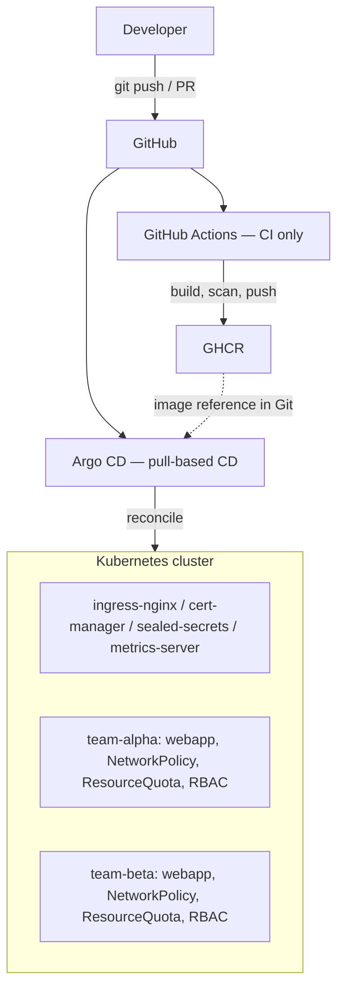

# gitops-k8s-platform

[](https://github.com/sofa4578/gitops-k8s-platform/actions/workflows/ci-manifests.yml)
[](https://github.com/sofa4578/gitops-k8s-platform/actions/workflows/ci-app.yml)
[](https://github.com/sofa4578/gitops-k8s-platform/actions/workflows/security.yml)
[](LICENSE)


A multi-tenant Kubernetes platform managed entirely through GitOps with
Argo CD, running locally on kind at zero cost.

TODO(sofiia): Record a ~10s self-heal GIF and embed it here — run
`scripts/drift-demo.sh` with `asciinema rec`, convert with `agg`, and
place the file at `docs/images/self-heal.gif`.

## What this is

Every change to this cluster's state — a new tenant, a bumped image tag,
a tightened network policy — goes through a pull request. Nothing is ever
applied by hand except a one-time bootstrap. Argo CD runs inside the
cluster, continuously compares what's declared in this Git repository to
what's actually running, and reconciles the difference. A manual
`kubectl edit` gets reverted automatically, usually within minutes.

The repository describes three layers: a **platform layer**
(ingress-nginx, cert-manager, sealed-secrets, metrics-server) that a
platform team would own; a **tenant layer** — two isolated namespaces,
`team-alpha` and `team-beta`, each with its own RBAC, NetworkPolicy and
ResourceQuota; and an **application layer** — a hand-written Helm chart
parameterized for `dev` and `prod`. This project exists to demonstrate
GitOps reconciliation, Helm chart authorship, tenant isolation, and
Kubernetes secrets handling in one coherent system, not to run real
production traffic.

## Architecture



**CI has no cluster credentials.** `.github/workflows/ci-app.yml` and
`ci-manifests.yml` hold no kubeconfig, no cluster token, no
`kubectl apply` step anywhere — see `docs/architecture.md` for the full
connection-by-connection breakdown and ADR 001 for why.

## Technology stack

| Technology | Purpose |
|---|---|
| kind | Local Kubernetes cluster (1 control-plane + 2 workers) |
| Argo CD (v2.13.2) | Pull-based continuous delivery, app-of-apps |
| Helm | The hand-written `charts/webapp` chart |
| ingress-nginx / cert-manager | HTTP routing and TLS lifecycle |
| Sealed Secrets | Secrets committed to Git as ciphertext |
| GitHub Actions | Validation, build, image scan — never cluster access |
| Trivy / kubeconform / gitleaks | Image, manifest and secret scanning |

## Features

- App-of-apps bootstrap: one command from an empty machine to a running platform
- Two isolated tenants: RBAC, NetworkPolicy, ResourceQuota, Pod Security Admission
- A hand-written Helm chart with `values.schema.json` validation
- Sealed Secrets: encrypted secrets committed to Git
- Automatic drift correction — see Demonstrations below
- PR-based promotion from dev to prod, the exact same image digest both times
- TLS via cert-manager (self-signed locally, Let's Encrypt DNS-01 optional)
- A validation-first CI pipeline: yamllint, helm lint, helm unittest, kubeconform, Trivy, gitleaks

## Prerequisites

docker, kind 0.25.0+, kubectl 1.37+, helm 3.21.4, kubeseal 0.27.1 (only to
seal a secret). See `docs/bootstrap.md` for the full version table and
memory requirements.

## Quick start

```bash
make up          # create the kind cluster
make bootstrap   # install Argo CD, apply the root Application, wait for sync
make verify      # assert the platform is actually healthy
```

Full walkthrough, expected output at each step, and the two most likely
first-run snags: `docs/bootstrap.md`.

## Repository layout

```text
bootstrap/     Applied by hand, once: Argo CD itself + the root app-of-apps Application
platform/      Platform components as Argo Applications (ingress-nginx, cert-manager, ...)
charts/webapp/ The hand-written Helm chart every tenant release uses
tenants/       One directory per tenant: namespace, RBAC, quota, NetworkPolicy, AppProject
envs/          Values-only overlays (dev / prod) — no templates
src/webapp/    The FastAPI application and its Dockerfile
scripts/       bootstrap, verify, drift-demo, teardown, seal-secret
docs/          Architecture, runbooks, ADRs, security model
.github/       CI workflows, CODEOWNERS, dependabot
```

## How deployment works

A version moves from a `git push` to running in prod through exactly two
pull requests — one automated (dev), one manual (prod) — never a direct
commit and never a rebuild between environments. See `docs/promotion.md`
for the full flow and a concrete one-line diff.

## CI/CD

```text
PR -> ci-manifests.yml (yamllint, helm lint, helm unittest, kubeconform matrix, trivy config)
   -> required checks, merge blocked until green
main push (src/webapp/**) -> ci-app.yml (ruff, pytest, build, trivy image scan, push to GHCR)
                           -> promote.yml (opens a PR bumping envs/dev/*.yaml)
```

CI never receives a kubeconfig, a cluster token, or a step that runs
`kubectl apply` against a live API server — Argo CD pulls from Git, CI
never pushes to the cluster. This is the platform's central security
property; `docs/architecture.md` covers why in full.

## Security

Sealed Secrets for anything sensitive, RBAC scoped per tenant via Argo CD
`AppProject`, default-deny NetworkPolicy with explicit DNS/ingress allows,
Pod Security Admission in `restricted` mode, Trivy gating on CRITICAL
before any image is pushed, and every third-party GitHub Action pinned by
commit SHA. Full threat model and the sealed-secrets key backup procedure:
`docs/security.md`.

## Reliability

| Component fails | Consequence | Traffic affected? |
|---|---|---|
| Argo CD | New changes stop applying, drift stops being corrected | No |
| ingress-nginx | External traffic stops entirely | Yes, fully |
| cert-manager | Certificates stop renewing; existing ones keep working until expiry | No, deferred |
| sealed-secrets | New SealedSecrets can't decrypt; existing Secrets are unaffected | No |
| metrics-server | HPA stops scaling, holds the last replica count | No, while load is stable |
| One worker node | Pods reschedule; PDB protects availability | Brief degradation |
| GitHub unreachable | Argo CD sees no new commits; cluster keeps running | No |

TODO(sofiia): Measured recovery time — run
`make down && make up && make bootstrap`, time the full sequence with
`time`, and insert the number of minutes here. `scripts/bootstrap.sh`
prints per-step timestamps to make this easy to read off.

## Demonstrations

### Drift correction
TODO(sofiia): Run `scripts/drift-demo.sh` and paste its output here (it
prints a `t+Ns: replicas=N` line per poll), plus a screenshot of the
Argo CD UI showing the Application flash `OutOfSync` and return to
`Synced`.

### Tenant isolation
TODO(sofiia): Screenshot the timeout from `scripts/verify.sh`'s isolation
check, or run it manually:
`kubectl -n team-alpha run tmp --rm -it --image=curlimages/curl --restart=Never -- curl -m 5 http://team-beta-prod-webapp.team-beta.svc.cluster.local`
and capture the timeout.

### Rollback
TODO(sofiia): Screenshot of `git revert <sha-of-image-bump> && git push`
next to the Argo CD Application returning to the previous image, with the
elapsed time noted.

### Blocked merge
TODO(sofiia): Open a PR that sets an `envs/*.yaml` `image.tag` to
`latest`, let `ci-manifests` fail on schema validation, and screenshot
the blocked merge button.

### Argo CD UI
TODO(sofiia): Screenshot of the Argo CD UI's Application tree after
`make bootstrap`, all nodes green.

## Troubleshooting

Full runbook: `docs/troubleshooting.md`. The two most common issues:

- **DNS hangs inside a tenant namespace** — a default-deny NetworkPolicy
  blocks port 53 unless egress to `kube-system` is explicitly allowed on
  both UDP and TCP. See scenario 2.
- **Replica count oscillates** — Argo CD and the HPA both trying to own
  `spec.replicas`. The fix is to never render that field when autoscaling
  is enabled, not to disable `selfHeal`. See scenario 5.

## Architecture decisions

- [ADR 001](docs/decisions/001-pull-based-cd.md) — pull-based delivery via Argo CD, not `kubectl apply` in CI.
- [ADR 002](docs/decisions/002-secrets-management.md) — Sealed Secrets over SOPS or External Secrets Operator.
- [ADR 003](docs/decisions/003-single-repo-vs-split.md) — one repository for platform, tenants, and application code.
- [ADR 004](docs/decisions/004-helm-vs-kustomize.md) — Helm for the chart, Kustomize for bootstrapping Argo CD.

## Known limitations

- Argo CD runs as a single replica (non-HA) — a real deployment would run it with multiple controller/repo-server replicas.
- Runs on a local kind cluster, not a cloud-managed one.
- TLS is self-signed locally; the Let's Encrypt DNS-01 issuer (`platform/cert-manager/issuers/letsencrypt.yaml`) exists but needs a real domain and Cloudflare token to actually issue a certificate. To use real TLS with Let's Encrypt, override the `cert-manager.io/cluster-issuer` annotation to `letsencrypt-prod` or `letsencrypt-staging` in your env values file and apply `platform/cert-manager/issuers/letsencrypt.yaml`.
- No log aggregation — `kubectl logs` only. A full stack (Loki/ELK) is deliberately out of scope for this project; see the observability project this platform is designed to later host.
- No stateful workloads and no backup/restore story beyond the sealed-secrets private key (see `docs/security.md`) and the Git repository itself.

## What I learned

TODO(sofiia): Write 3-5 sentences in your own words about what was
hardest, what surprised you, and what you'd do differently next time.
Don't leave this as generated text — this is the section an interviewer
actually reads first.

## Future improvements

Argo Rollouts for canary deployments with automated analysis, Kyverno or
Gatekeeper to enforce policy at admission time instead of only in CI,
External Secrets Operator for centralized secret rotation, and
multi-cluster support via an `ApplicationSet` generator once tenant count
grows past what one cluster should hold.

## License

[MIT](LICENSE)
